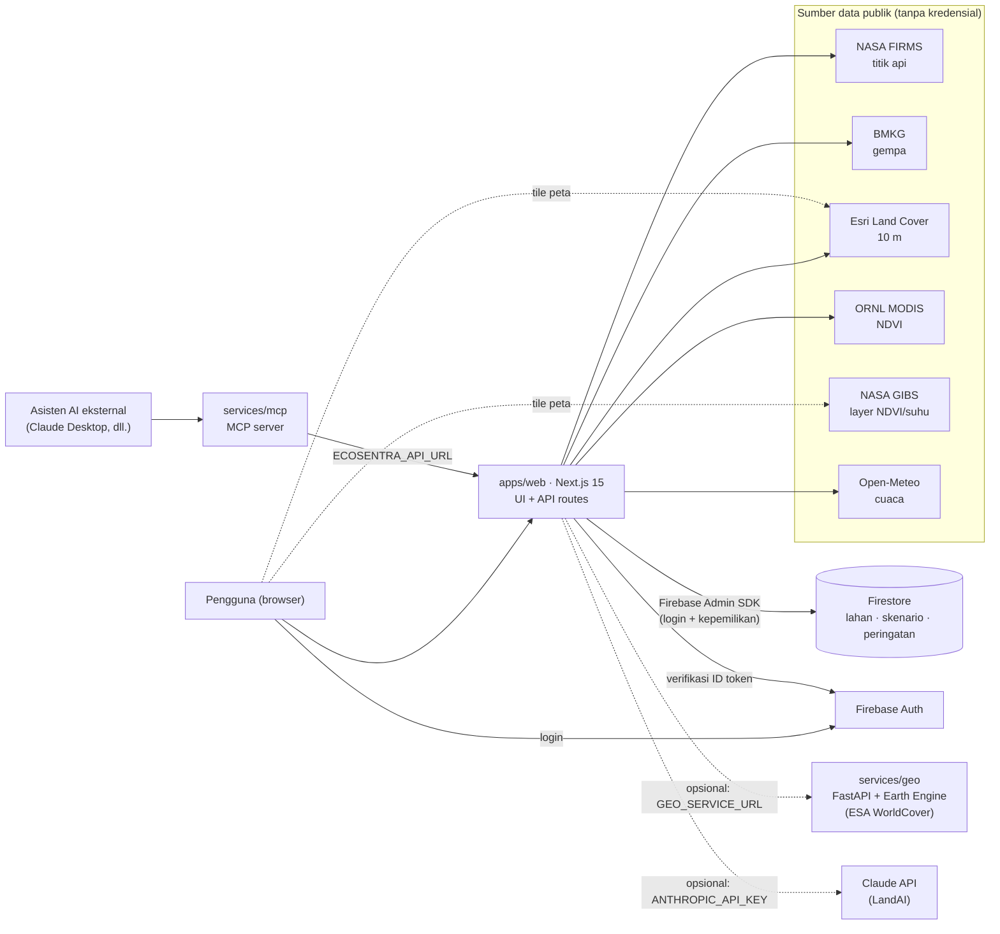

# 🌿 EcoSentra - Platform Analisis Lahan & Ekosistem Indonesia

### Pantau lahan dan ekosistem Indonesia dari **data satelit & lembaga resmi yang terbuka**, lengkap dengan sumber dan keterbatasannya.

_Satu platform untuk titik api, gempa, kehijauan vegetasi, tutupan lahan, dan cuaca. Dilengkapi **asisten LandAI**, **MCP Server (5 tool)**, dan **mode demo tanpa kredensial**._

**Peta & Analisis • Dashboard • Peringatan Bencana • Profil Ekosistem • Lahan Saya • Pendukung Keputusan • LandAI • MCP Server • Ekspor GeoJSON/CSV/KML • Tanpa Data Karangan**

---

<div align="center">


[](https://github.com/PashaAkrilian/Ecosentra/actions/workflows/ci.yml)
[](https://github.com/PashaAkrilian/Ecosentra/actions/workflows/cd.yml)
[](./License.txt)


[](https://github.com/PashaAkrilian/Ecosentra/stargazers)
[](https://github.com/PashaAkrilian/Ecosentra/issues)
[](https://github.com/PashaAkrilian/Ecosentra/commits/main)
[](https://github.com/PashaAkrilian/Ecosentra)
[](https://github.com/PashaAkrilian/Ecosentra/pulls?q=is%3Apr+is%3Aclosed)
[](https://github.com/PashaAkrilian/Ecosentra/graphs/contributors)
[](https://github.com/PashaAkrilian/Ecosentra/network/members)
[](https://github.com/PashaAkrilian/Ecosentra/watchers)

[⚡ Quick Start](#-quick-start) • [💡 Fitur](#-fitur-utama) • [📡 Sumber Data](#-sumber-data-sekilas) • [🔌 API](#-endpoint-alat-landai--tool-mcp) • [📖 Dokumentasi](#-dokumentasi) • [🧭 Roadmap](#-roadmap)

</div>

🌐 **Bahasa:** 🇮🇩 Bahasa Indonesia (UI, pesan validasi, dokumentasi, dan komentar kode)

---

## 📸 Halaman Aplikasi

<details>
<summary><b>Klik untuk melihat semua halaman</b></summary>

| Halaman                  | Rute                | Isi                                                                                          | Perlu login?        |
| ------------------------ | ------------------- | -------------------------------------------------------------------------------------------- | ------------------- |
| **Beranda**              | `/`                 | Kondisi terkini (titik api 24 jam, provinsi teratas, gempa terbaru), fitur, sumber data      | Tidak               |
| **Dashboard**            | `/dashboard`        | Titik api 24 jam, tren 7 hari, provinsi teratas, gempa M 5+, peringatan aktif                | Tidak               |
| **Peta & Analisis**      | `/maps`             | Layer titik api, gempa, NDVI, suhu permukaan, tutupan lahan; analisis titik; ekspor          | Tidak               |
| **Peringatan Bencana**   | `/disaster-alerts`  | Peringatan otomatis (BMKG, NASA FIRMS) dan peringatan kurasi admin                           | Admin (menerbitkan) |
| **Profil Ekosistem**     | `/ecosystem`        | Komposisi tutupan lahan dan kepadatan titik api untuk 34 provinsi                            | Tidak               |
| **Lahan Saya**           | `/fields`           | Lahan tersimpan, analisis tutupan lahan berkala, kondisi terkini                             | **Ya**              |
| **Pendukung Keputusan**  | `/decision-support` | Skenario pengelolaan lahan, konteks data terkini, rekomendasi indikatif                      | **Ya**              |
| **Pengaturan**           | `/settings`         | Profil, status integrasi, hapus akun dan data                                                | Sebagian            |
| **Bantuan & Metodologi** | `/help`             | Cara pakai, sumber data, metodologi peringatan, keterbatasan, privasi, mode demo             | Tidak               |
| **Masuk / Daftar**       | `/login`            | Email & kata sandi, atau akun Google                                                         | -                   |

</details>

<!--
  Tempat screenshot: simpan gambar di docs/screenshots/ (nama snake_case, mis. dashboard.png,
  peta_analisis.png), lalu tambahkan bagian seperti ini di atas tabel:

  <div align="center">
    
  </div>
-->

---

### 📡 Ditenagai data terbuka dari lembaga tepercaya

_Setiap angka diambil langsung dari penyedia aslinya, bukan disalin ke database atau dikarang._

<table>
  <tr>
    <td align="center" width="140">
      <a href="https://firms.modaps.eosdis.nasa.gov/active_fire/">🔥<br/><b>NASA FIRMS</b></a><br/>
      <sub>Titik api VIIRS 375 m</sub>
    </td>
    <td align="center" width="140">
      <a href="https://data.bmkg.go.id/gempabumi/">🌋<br/><b>BMKG</b></a><br/>
      <sub>Gempa M 5+ & dirasakan</sub>
    </td>
    <td align="center" width="140">
      <a href="https://modis.ornl.gov/data/modis_webservice.html">🌱<br/><b>NASA MODIS</b></a><br/>
      <sub>NDVI 250 m via ORNL DAAC</sub>
    </td>
    <td align="center" width="140">
      <a href="https://livingatlas.arcgis.com/landcover/">🧩<br/><b>Esri 10 m</b></a><br/>
      <sub>Tutupan lahan Sentinel-2</sub>
    </td>
    <td align="center" width="140">
      <a href="https://open-meteo.com">💧<br/><b>Open-Meteo</b></a><br/>
      <sub>Cuaca & kelembapan tanah</sub>
    </td>
  </tr>
  <tr>
    <td align="center" width="140">
      <a href="https://earthdata.nasa.gov/gibs">🛰️<br/><b>NASA GIBS</b></a><br/>
      <sub>Layer NDVI & suhu permukaan</sub>
    </td>
    <td align="center" width="140">
      <a href="https://esa-worldcover.org/">🌍<br/><b>ESA WorldCover</b></a><br/>
      <sub>Opsional, via Earth Engine</sub>
    </td>
    <td align="center" width="140">
      <a href="https://www.geoboundaries.org/">🧭<br/><b>geoBoundaries</b></a><br/>
      <sub>Batas 34 provinsi</sub>
    </td>
    <td align="center" width="140">
      <a href="https://www.openstreetmap.org/copyright">🗺️<br/><b>OpenStreetMap</b></a><br/>
      <sub>Peta dasar</sub>
    </td>
    <td align="center" width="140">
      <a href="https://docs.claude.com">🤖<br/><b>Claude</b></a><br/>
      <sub>Opsional, untuk LandAI</sub>
    </td>
  </tr>
</table>

<sub>📡 Semua data diambil oleh server lewat <code>/api/*</code>, di-cache sebentar, dan selalu tampil bersama sumber + waktu pengambilan</sub>

---

## 🤔 Kenapa EcoSentra?

**Memantau lahan di Indonesia itu merepotkan:**

-  Data tersebar di banyak portal (NASA, BMKG, ESA, Esri) dengan format berbeda: CSV, JSON, ImageServer, WMTS
-  Angka tanpa sumber dan waktu pengambilan sulit dipercaya, apalagi diverifikasi
-  Titik api mudah disalahartikan sebagai kebakaran pasti, dan awan sering merusak data vegetasi
-  Butuh akun, API key, atau perangkat GIS hanya untuk sekadar mencoba

**EcoSentra menyelesaikannya:**

- ✅ **Satu tempat** - titik api, gempa, NDVI, tutupan lahan, dan cuaca dalam satu peta dan dashboard
- ✅ **Selalu bersumber** - setiap angka tampil dengan sumber, waktu pengambilan, dan keterbatasannya
- ✅ **Jujur soal keterbatasan** - observasi berawan ditandai, titik api disebut anomali panas yang perlu verifikasi lapangan
- ✅ **Langsung jalan** - mode demo tanpa kredensial; akun, LandAI penuh, dan Earth Engine bisa ditambahkan bertahap

---

## 📧 Dukungan

> 💬 **Punya pertanyaan, ide, atau menemukan bug?** Buka [Issue](https://github.com/PashaAkrilian/Ecosentra/issues) lengkap dengan langkah untuk mereproduksinya.

- **GitHub**: [github.com/PashaAkrilian/Ecosentra](https://github.com/PashaAkrilian/Ecosentra)
- **Issues**: [github.com/PashaAkrilian/Ecosentra/issues](https://github.com/PashaAkrilian/Ecosentra/issues)
- **Kontribusi**: lihat [Cara Berkontribusi](#cara-berkontribusi) dan [`docs/git-workflow.md`](docs/git-workflow.md)
- **Metodologi & keterbatasan data**: halaman `/help` di aplikasi dan [`docs/data-sources.md`](docs/data-sources.md)
- **Keamanan**: model ancaman dan status audit di [`docs/security-checklist.md`](docs/security-checklist.md)

### 🐛 Melaporkan Bug?

Sertakan keluaran endpoint healthcheck. Isinya hanya status integrasi (boolean), **tanpa nilai rahasia**, jadi aman ditempel di issue:

```bash
curl -s http://localhost:8080/api/healthcheck
node --version
```

Tambahkan juga browser yang dipakai, rute halaman (mis. `/maps`), dan pesan galat yang muncul di layar atau di log server.

---

## 🔄 Cara Kerja

```
┌─────────────────────────────┐   ┌─────────────────────────────┐
│ Browser pengguna            │   │ Asisten AI eksternal        │
│ Peta · Dashboard · LandAI   │   │ (Claude Desktop, dll.)      │
└──────────────┬──────────────┘   └──────────────┬──────────────┘
               │                                 │ MCP (stdio)
               │                                 ↓
               │                  ┌─────────────────────────────┐
               │                  │ services/mcp (5 tool)       │
               │                  └──────────────┬──────────────┘
               │ /api/*                          │ HTTP · ECOSENTRA_API_URL
               ↓                                 ↓
┌───────────────────────────────────────────────────────────────┐
│            apps/web · Next.js 15 (UI + API routes)            │
│ • Validasi Zod + rate limit per IP                            │
│ • Cache stale-while-revalidate, dipanaskan saat server start  │
│ • Titik api diklasifikasi ke 34 provinsi (point-in-polygon)   │
│ • Firebase Admin SDK: verifikasi token + kepemilikan data     │
│ • LandAI: satu set alat data untuk mode aturan & mode Claude  │
└──────┬────────────────────────────────────────────────────────┘
       │
       ├─→ [DATA PUBLIK · tanpa kredensial]
       │     NASA FIRMS · BMKG · Esri 10 m · ORNL MODIS · Open-Meteo
       │
       ├─→ [DATA PRIBADI · butuh login]
       │     Firestore: lahan · skenario · peringatan kurasi
       │
       ├─→ [OPSIONAL] services/geo → Google Earth Engine (ESA WorldCover)
       │     ↓ tidak di-set atau gagal
       │     Esri 10 m (fallback otomatis)
       │
       └─→ [OPSIONAL] Claude API → LandAI mode Claude
             ↓ tanpa ANTHROPIC_API_KEY
             LandAI mode aturan (gratis, tanpa model bahasa)

Tile peta (OSM, Esri, OpenTopoMap, NASA GIBS) dimuat langsung oleh browser.
Hasil: setiap angka tampil bersama sumber, waktu ambil, dan keterbatasannya.
```

---

## 🎯 Apa yang Diselesaikan EcoSentra: 12 Masalah Nyata & Use Case

> **Petani, relawan kebencanaan, peneliti, mahasiswa, sampai developer AI menghadapi masalah yang sama:** data lingkungan Indonesia sebenarnya terbuka, tapi sulit dipakai. EcoSentra menjembataninya tanpa mengorbankan kejujuran data.

<details>
<summary><b>🔥 1. "Saya ingin tahu titik api di provinsi saya hari ini, tapi data NASA berupa CSV mentah"</b></summary>

NASA FIRMS menerbitkan deteksi anomali panas sebagai CSV untuk seluruh Asia Tenggara, berisi koordinat dan nilai teknis tanpa nama provinsi. Untuk tahu kondisi satu provinsi, pengguna harus mengunduh, memfilter, dan memetakannya sendiri.

**Bagaimana EcoSentra menyelesaikannya:**

- **Tanpa MAP_KEY** - CSV publik VIIRS 375 m (`SouthEast_Asia_{24h,48h,7d}`) diambil server; satelit dipilih lewat `FIRMS_SATELLITE` (`snpp`, `noaa20`, `noaa21`)
- **Difilter ke daratan Indonesia** - klasifikasi point-in-polygon ke 34 provinsi (batas geoBoundaries yang disederhanakan, selisih < 0,1% terhadap data tanpa penyederhanaan)
- **Ringkasan siap baca** - total, keyakinan tinggi, per provinsi, per pulau, dan per hari (dihitung dalam WIB)
- **Ekspor** - GeoJSON, CSV, atau KML (maks 25.000 titik) untuk QGIS, Google Earth, R, atau Python
- **Tautan yang bisa dibagikan** - titik yang dipilih di peta (koordinat + zoom) tersimpan di URL, siap dikirim ke rekan

</details>

<details>
<summary><b>🌋 2. "Saya butuh ringkasan gempa terkini tanpa membuka banyak halaman"</b></summary>

BMKG menyediakan beberapa feed terpisah (gempa terbaru, gempa M 5+, gempa dirasakan). Menyatukannya dan menilai mana yang penting butuh waktu, padahal informasinya dibutuhkan cepat.

**Bagaimana EcoSentra menyelesaikannya:**

- **Tiga feed BMKG** (`autogempa`, `gempaterkini`, `gempadirasakan`) digabung tanpa duplikat, cache 1 menit
- **Peringatan otomatis** - M ≥ 7 atau berpotensi tsunami = kritis, M ≥ 6 = tinggi, M ≥ 5 = sedang; gempa kecil hanya muncul bila dirasakan warga
- **Langsung ke peta** - setiap peringatan menautkan ke lokasi kejadian di peta
- **Atribusi BMKG** selalu dicantumkan, sesuai syarat Data Terbuka BMKG

</details>

<details>
<summary><b>🌱 3. "Saya ingin memantau vegetasi kebun atau sawah, tapi tidak paham citra satelit"</b></summary>

NDVI adalah indikator kehijauan vegetasi yang umum dipakai, tetapi mengunduh dan membaca citra MODIS butuh keahlian khusus. Di Indonesia, awan juga sering membuat nilai NDVI tidak andal.

**Bagaimana EcoSentra menyelesaikannya:**

- **NDVI MODIS MOD13Q1** via ORNL DAAC - deret ±10 bulan komposit 16 hari untuk titik mana pun
- **Awan ditandai** - observasi berawan (band `pixel_reliability`) digambar berongga dan tidak disambung garis, supaya nilai yang tidak andal tidak disalahartikan
- **Lahan Saya** - simpan lokasi lahan, lalu lihat kondisi terkini: NDVI, cuaca, dan titik api di sekitarnya
- **Layer peta NDVI & suhu permukaan** dari NASA GIBS, dengan legenda dari colormap resmi

</details>

<details>
<summary><b>🧩 4. "Saya perlu tahu komposisi tutupan lahan suatu area atau provinsi"</b></summary>

Peta tutupan lahan global tersedia gratis, tetapi menghitung persentase kelas untuk area tertentu biasanya butuh software GIS atau Google Earth Engine.

**Bagaimana EcoSentra menyelesaikannya:**

- **Esri / Impact Observatory 10 m** (Sentinel-2) lewat ImageServer publik, tanpa kredensial
- **Radius bebas 100 m - 50 km** di sekitar titik mana pun; hasilnya kelas dominan dan persentase tiap kelas
- **Profil Ekosistem** - komposisi tutupan lahan dan kepadatan titik api untuk 34 provinsi
- **ESA WorldCover (opsional)** via Google Earth Engine (`services/geo`) dengan kelas mangrove dan lahan basah terpisah; otomatis kembali ke Esri bila layanan gagal
- **Dataset & tahun selalu disebut** di respons, karena skema kelas kedua dataset berbeda

</details>

<details>
<summary><b>💧 5. "Saya butuh info cuaca dan kelembapan tanah untuk keputusan di lapangan"</b></summary>

Keputusan seperti waktu tanam, penyiraman, atau kesiapsiagaan kebakaran bergantung pada cuaca dan kondisi tanah, tetapi data itu jarang tersedia berdampingan dengan data satelit lain.

**Bagaimana EcoSentra menyelesaikannya:**

- **Open-Meteo** - kondisi terkini, prakiraan 7 hari, dan kelembapan tanah (model), cache 15 menit
- **Terpadu di analisis titik** - klik satu lokasi di peta, cuaca muncul bersama NDVI, tutupan lahan, dan titik api terdekat
- **Dipakai rekomendasi** - prakiraan kering + tanah kering, hujan lebat, dan suhu tinggi memicu catatan di Pendukung Keputusan

</details>

<details>
<summary><b>🎯 6. "Saya butuh bahan pertimbangan sebelum mengambil keputusan pengelolaan lahan"</b></summary>

Data mentah tidak otomatis menjadi keputusan. Pengelola lahan butuh ringkasan yang mengarahkan perhatian, tanpa berpura-pura menggantikan penilaian manusia.

**Bagaimana EcoSentra menyelesaikannya:**

- **Skenario per kategori** - pertanian, kehutanan, kebencanaan, konservasi
- **Konteks data terkini** untuk skenario berlokasi - titik api sekitar, cuaca, tren NDVI, tutupan lahan
- **Rekomendasi indikatif berbasis aturan** dengan tiga tingkat (tindakan, perhatian, info); ambangnya tertulis di `lib/recommendations.ts` dan dijelaskan di UI
- **Bukan keputusan otomatis** - tujuannya mengarahkan perhatian, bukan memutuskan

</details>

<details>
<summary><b>🤖 7. "Saya ingin bertanya dengan bahasa sehari-hari, bukan membaca grafik"</b></summary>

Tidak semua pengguna nyaman membaca peta dan grafik. Pertanyaan seperti "berapa titik api di Kalimantan Tengah hari ini?" seharusnya bisa dijawab langsung, dengan angka yang benar.

**Bagaimana EcoSentra menyelesaikannya:**

- **LandAI mode aturan (gratis)** - tanpa model bahasa; jawaban disusun dari data asli dan tidak pernah mengarang angka
- **LandAI mode Claude** - tool use + streaming (NDJSON) saat `ANTHROPIC_API_KEY` diisi
- **7 alat data** - `get_fire_hotspots`, `get_earthquakes`, `get_weather`, `get_ndvi`, `get_land_cover`, `get_province_land_cover`, `get_location_briefing`
- **Pertanyaan berkoordinat** - "risikonya apa di -2.21, 113.91?" dijawab dengan ringkasan lokasi: titik api sekitar, cuaca, NDVI, tutupan lahan, dan rekomendasi
- **"Tanya LandAI"** tersedia dari halaman lain, termasuk detail skenario dan titik terpilih di peta

</details>

<details>
<summary><b>🔌 8. "Saya ingin asisten AI saya sendiri (Claude Desktop) memakai data ini"</b></summary>

Asisten AI umum tidak punya akses ke data lingkungan Indonesia yang terkini, sehingga jawabannya bisa usang atau dikarang.

**Bagaimana EcoSentra menyelesaikannya:**

- **`services/mcp`** - 5 tool (`get_fire_hotspots`, `get_earthquakes`, `get_weather`, `get_ndvi`, `get_land_cover`) di atas API EcoSentra, jadi angkanya identik dengan dashboard
- **Kompatibel `mcp` 1.x & 2.x** - `server.py` menangani perubahan nama `FastMCP` → `MCPServer`
- **Output teks berbahasa Indonesia** dengan sumber & keterbatasan; galat dikembalikan sebagai teks, tool tidak pernah crash
- **Siap Docker** - `docker run -i` untuk transport stdio

</details>

<details>
<summary><b>🧾 9. "Banyak dashboard menampilkan angka contoh yang terlihat seperti data asli"</b></summary>

Angka dummy yang tidak ditandai bisa menyesatkan, terutama untuk topik bencana dan lingkungan.

**Bagaimana EcoSentra menyelesaikannya:**

- **Tanpa data karangan** - setiap tampilan data mencantumkan sumber dan waktu pengambilan
- **Gagal = galat yang jujur** - bila sumber gagal dan belum ada data, UI menampilkan galat dengan tombol coba lagi, bukan angka cadangan
- **Halaman Bantuan & Metodologi** - cara pakai, sumber data, metodologi peringatan, keterbatasan, privasi, dan mode demo
- **Satu-satunya mock** ada di tool MCP `get_land_cover` saat belum dikonfigurasi, dan keluarannya ditandai `[MOCK]`

</details>

<details>
<summary><b>🔒 10. "Data lahan saya tidak boleh bisa dibaca orang lain"</b></summary>

Lokasi kebun, skenario, dan profil adalah data pribadi. Aplikasi berbasis Firebase sering membuka Firestore langsung ke klien, sehingga aturan yang keliru bisa membocorkan data.

**Bagaimana EcoSentra menyelesaikannya:**

- **Firestore hanya lewat server** (Admin SDK); `firestore.rules` menolak semua akses klien langsung
- **ID token diverifikasi** di setiap permintaan; dokumen milik orang lain dijawab `404` (sengaja tidak dibedakan)
- **Admin = custom claim** di token, bukan field yang bisa ditulis pengguna
- **Validasi Zod `.strict()`**, batas body 100 KB, rate limit per IP, CSP & header keamanan
- **Hak hapus data** - hapus akun ikut menghapus **semua** data milik pengguna

</details>

<details>
<summary><b>🐢 11. "Server NASA jauh dan sering timeout dari Indonesia"</b></summary>

Dari Indonesia, `fetch` Node.js ke server NASA sempat gagal `ETIMEDOUT`: handshake TCP sekitar 265 ms melewati batas bawaan Node 250 ms. Unduhan CSV FIRMS juga bisa memakan 5-60 detik.

**Bagaimana EcoSentra menyelesaikannya:**

- **`NET_ATTEMPT_TIMEOUT_MS`** (default 5000) di `instrumentation.node.ts`
- **Cache stale-while-revalidate** - setelah panggilan pertama, pengguna langsung mendapat data terakhir sementara pembaruan berjalan di latar belakang
- **Pemanasan cache** saat server start
- **Tahan gangguan** - bila sumber sedang gagal, data terakhir yang berhasil diambil tetap disajikan bersama waktu pengambilannya

</details>

<details>
<summary><b>🧪 12. "Saya ingin mencoba tanpa membuat akun Firebase atau API key apa pun"</b></summary>

Banyak proyek open source gagal dijalankan di menit pertama karena butuh kredensial yang tidak dimiliki pengguna.

**Bagaimana EcoSentra menyelesaikannya:**

- **Mode demo** - `npm ci && npm run dev` langsung memakai data asli dari sumber publik
- **Build tanpa secret** - Firebase Admin diinisialisasi saat dibutuhkan saja
- **Firebase Emulator** - login, lahan, skenario, dan peran admin bisa dicoba sepenuhnya di lokal
- **CI tanpa secret** - lint, type-check, test, build, audit, uji emulator, ruff/pytest, dan build Docker

</details>

### Contoh Alur Kerja (Use Case Terpadu)

**Alur A: Pemantauan karhutla harian (relawan, BPBD, komunitas)**

```txt
1. Dashboard            → provinsi teratas 24 jam & tren 7 hari
2. Peringatan Bencana   → peringatan kebakaran per provinsi (ambang 20 / 100 / 500 titik)
3. Klik peringatan      → peta langsung terfokus ke lokasinya
4. Peta & Analisis      → klik titik: tutupan lahan, NDVI, cuaca, titik api terdekat
5. Ekspor               → KML untuk Google Earth, GeoJSON untuk QGIS

Hasil: daftar lokasi prioritas untuk verifikasi lapangan, lengkap dengan sumbernya
```

**Alur B: Memantau kebun atau sawah sendiri**

```txt
1. Masuk (email atau Google)
2. Lahan Saya           → tambah lahan (nama, jenis tanaman, luas, lokasi)
3. Analisis             → snapshot tutupan lahan tersimpan sebagai riwayat
4. Kondisi terkini      → NDVI (awan ditandai), cuaca 7 hari, titik api di sekitar
5. Tanya LandAI         → "bagaimana kondisi vegetasi di lahan saya?"
```

**Alur C: Data untuk tugas kuliah atau riset**

```bash
# Titik api Kalimantan Tengah 7 hari terakhir sebagai CSV (maks 25.000 titik)
curl -o titik_api_kalteng_7d.csv \
  "http://localhost:8080/api/hotspots/export?range=7d&province=kalteng&format=csv"

# Lalu olah di R / Python / QGIS, dan cantumkan atribusi: NASA FIRMS
```

**Alur D: Data EcoSentra di Claude Desktop (MCP)**

```txt
1. Jalankan apps/web (lokal atau URL deploy)
2. Jalankan services/mcp dengan ECOSENTRA_API_URL
3. Daftarkan di claude_desktop_config.json
4. Tanya: "Berapa titik api di Riau 48 jam terakhir?"
   → get_fire_hotspots(province="Riau", range="48h")
```

---

## 🆓 Mulai Gratis: Tanpa Kredensial Apa Pun

> Jalankan EcoSentra dalam hitungan menit dengan **nol konfigurasi**. Fitur lain bisa diaktifkan bertahap sesuai kebutuhan.

| Langkah | Aksi                                                                        | Yang Terbuka                                                                                       |
| ------- | --------------------------------------------------------------------------- | -------------------------------------------------------------------------------------------------- |
| 1       | `npm ci && npm run dev` di `apps/web`, **tanpa `.env`**                     | Peta, dashboard, peringatan otomatis, profil ekosistem, ekspor, LandAI mode aturan: **gratis**     |
| 2       | Isi `NEXT_PUBLIC_FIREBASE_*` + `FIREBASE_*` (atau pakai Firebase Emulator)  | Login (email & Google), Lahan Saya, Pendukung Keputusan, peringatan kurasi admin                   |
| 3       | Isi `ANTHROPIC_API_KEY`                                                     | LandAI mode Claude (tool use + streaming)                                                          |
| 4       | Jalankan `services/geo` + isi `GEO_SERVICE_URL`                             | Tutupan lahan ESA WorldCover via Earth Engine (kelas mangrove & lahan basah)                       |
| 5       | Jalankan `services/mcp`                                                     | Data EcoSentra di Claude Desktop atau klien MCP lain                                               |

**Buka:** `http://localhost:8080` · cek status integrasi di `/settings` · selesai.

> **Soal biaya:** semua sumber data publik di atas gratis (Open-Meteo gratis untuk penggunaan non-komersial). Biaya hanya muncul dari layanan yang Anda aktifkan sendiri, misalnya Claude API dan platform tempat Anda men-deploy.

---

## ⚡ Quick Start

### 1) Clone dan jalankan (mode demo)

```bash
git clone https://github.com/PashaAkrilian/Ecosentra.git
cd Ecosentra/apps/web
npm ci
npm run dev
```

> **Syarat:** Node.js ≥ 22.12 (dibutuhkan `firebase-admin` 14).

Aplikasi terbuka di `http://localhost:8080`. Panggilan pertama ke data titik api bisa 10-60 detik dari Indonesia (unduh CSV NASA); setelah itu cache yang melayani.

| Perintah                          | Fungsi                                                              |
| --------------------------------- | ------------------------------------------------------------------- |
| `npm run dev`                     | Server dev di `http://localhost:8080` (host `0.0.0.0`)              |
| `npm run build` / `npm start`     | Build produksi / jalankan hasil build                               |
| `npm run lint`                    | ESLint (`next/core-web-vitals`)                                     |
| `npm run typecheck`               | `tsc --noEmit`                                                      |
| `npm test`                        | Vitest, tanpa internet (memakai fixture respons asli)               |
| `npm run test:emulator`           | Uji integrasi dengan Admin SDK asli (butuh Firebase Emulator)       |
| `npm run seed -- <uid> [--admin]` | Data contoh untuk satu akun (+ peran admin)                         |

### 2) Aktifkan login & penyimpanan (Firebase)

1. Buat project di [Firebase Console](https://console.firebase.google.com/), aktifkan **Authentication** (Email/Password, opsional Google) dan **Firestore** (region `asia-southeast2` Jakarta).
2. Salin konfigurasi Web app ke `apps/web/.env.local` (`NEXT_PUBLIC_FIREBASE_*`).
3. Buat private key service account, lalu isi `FIREBASE_PROJECT_ID`, `FIREBASE_CLIENT_EMAIL`, `FIREBASE_PRIVATE_KEY`. **Jangan commit file kunci.**
4. Terapkan aturan keamanan: `npx firebase-tools deploy --only firestore:rules`
5. Buka `/settings`: semua integrasi yang Anda isi harus berstatus **Aktif**.

Belum punya project Firebase? Pakai Firebase Emulator (lihat [Panduan Setup](#-panduan-setup)).

### 3) Aktifkan LandAI penuh (Claude)

```bash
# apps/web/.env.local
ANTHROPIC_API_KEY=sk-ant-...
ANTHROPIC_MODEL=claude-opus-5-5   # default; lebih hemat: claude-sonnet-5-5 atau claude-haiku-4-5
```

Dengan Firebase aktif, mode Claude hanya untuk pengguna login (8 permintaan/menit/IP dan 150/hari/pengguna). Tanpa kunci, LandAI tetap berjalan dalam mode aturan.

### 4) Validasi semuanya

```bash
# di apps/web
npm run lint && npm run typecheck && npm test

# layanan Python (dari root repo)
(cd services/geo && pip install -r requirements-dev.txt && ruff check . && pytest -q)
(cd services/mcp && pip install -r requirements-dev.txt && ruff check . && pytest -q)
```

### Variabel Lingkungan (`apps/web`)

Semua variabel **opsional**. Penjelasan lengkap ada di [`apps/web/.env.local.example`](apps/web/.env.local.example).

| Variabel                                                                       | Default                | Fungsi                                                                                         |
| ------------------------------------------------------------------------------ | ---------------------- | ---------------------------------------------------------------------------------------------- |
| `NEXT_PUBLIC_FIREBASE_API_KEY`, `_AUTH_DOMAIN`, `_PROJECT_ID`, `_APP_ID`       | kosong                 | Firebase Client SDK, **hanya untuk login** di browser. Nilainya tertanam saat build            |
| `FIREBASE_PROJECT_ID`, `FIREBASE_CLIENT_EMAIL`, `FIREBASE_PRIVATE_KEY`         | kosong                 | Firebase Admin SDK untuk Firestore & verifikasi token (tidak perlu di Firebase App Hosting)    |
| `GEO_SERVICE_URL`                                                              | kosong → Esri 10 m     | URL `services/geo` (ESA WorldCover)                                                            |
| `GEO_SERVICE_API_KEY`                                                          | kosong                 | Dikirim sebagai header `X-API-Key` ke `services/geo`                                           |
| `FIRMS_SATELLITE`                                                              | `snpp`                 | Satelit sumber titik api: `snpp`, `noaa20`, `noaa21`                                           |
| `ANTHROPIC_API_KEY`                                                            | kosong → mode aturan   | Mengaktifkan LandAI mode Claude                                                                |
| `ANTHROPIC_MODEL`                                                              | `claude-opus-5-5`      | Model Claude untuk LandAI                                                                      |
| `NET_ATTEMPT_TIMEOUT_MS`                                                       | `5000`                 | Batas waktu koneksi per alamat; bawaan Node 250 ms terlalu pendek untuk server NASA dari Indonesia |
| `DISABLE_CACHE_WARMUP`                                                         | kosong                 | `1` = matikan pemanasan cache saat start (mis. di lingkungan test)                             |

---

## 🐳 Docker

Kedua layanan Python punya `Dockerfile` siap pakai (Python 3.12, berjalan sebagai user non-root). `apps/web` di-deploy sebagai aplikasi Next.js biasa (lihat [Deploy](#-deploy)).

**services/geo (ESA WorldCover):**

```bash
docker build -t ecosentra-geo services/geo

docker run -d \
  --name ecosentra-geo \
  --restart unless-stopped \
  -p 8001:7860 \
  -e GEE_CREDENTIALS_JSON="$(cat services/geo/credentials/gee-service-account.json)" \
  -e GEO_API_KEY=ganti-dengan-kunci-acak \
  ecosentra-geo

curl http://localhost:8001/health
```

**services/mcp (MCP server, transport stdio):**

```bash
docker build -t ecosentra-mcp services/mcp

# -i wajib: MCP berkomunikasi lewat stdin/stdout
docker run -i --rm -e ECOSENTRA_API_URL=https://ecosentra.example.com ecosentra-mcp
```

> Kalau `apps/web` berjalan di host yang sama, `localhost` di dalam container bukan host Anda. Pakai `http://host.docker.internal:8080` (Docker Desktop) atau `--network host` (Linux).

**Image dari CD:** setelah CI hijau di `main`, workflow CD membangun dan mendorong image ke GitHub Container Registry.

| Image                                 | Tag                         | Isi                                         |
| ------------------------------------- | --------------------------- | ------------------------------------------- |
| `ghcr.io/pashaakrilian/ecosentra-geo` | `latest`, SHA 7 karakter    | FastAPI + Earth Engine (ESA WorldCover)     |
| `ghcr.io/pashaakrilian/ecosentra-mcp` | `latest`, SHA 7 karakter    | MCP server (stdio)                          |

---

## 🚀 Deploy

| Target                         | Cara                                         | Catatan                                                                                                                        |
| ------------------------------ | -------------------------------------------- | ------------------------------------------------------------------------------------------------------------------------------ |
| **Vercel** (otomatis)          | `.github/workflows/cd.yml` setelah CI hijau  | Butuh secret `VERCEL_TOKEN`, `VERCEL_ORG_ID`, `VERCEL_PROJECT_ID`; Root Directory = `apps/web`. Tanpa secret, langkah dilewati |
| **Firebase App Hosting**       | `firebase deploy --only hosting`             | `firebase.json` sudah menunjuk `apps/web` di region `asia-southeast2`; Admin SDK memakai Application Default Credentials       |
| **Cloud Run / VPS / lainnya**  | `next build && next start -p $PORT`          | Node ≥ 22.12; semua `NEXT_PUBLIC_*` harus diset **saat build**                                                                 |
| **services/geo**               | Docker (Cloud Run, Railway, HF Spaces)       | Isi `GEE_CREDENTIALS_JSON` lewat secret manager; **wajib set `GEO_API_KEY`** pada layanan publik                               |

**Checklist self-hosting:**

- Izinkan jaringan keluar ke `firms.modaps.eosdis.nasa.gov`, `data.bmkg.go.id`, `ic.imagery1.arcgis.com`, `modis.ornl.gov`, dan `api.open-meteo.com`
- Di belakang reverse proxy: teruskan `X-Forwarded-For` (dipakai rate limit per IP) dan **jangan mem-buffer** respons `/api/chat` (streaming)
- Rahasia (`FIREBASE_PRIVATE_KEY`, `ANTHROPIC_API_KEY`) sebaiknya lewat secret manager, bukan file
- Cache & rate limit bersifat in-memory per instance; untuk beberapa instance, gunakan Redis atau pindahkan rate limit ke CDN/WAF

📖 Panduan lengkap: [`docs/deployment.md`](docs/deployment.md) · Pipeline: [`docs/ci-cd.md`](docs/ci-cd.md)

---

## 📡 Sumber Data Sekilas

| Kategori                      | Sumber                                      | Dipakai untuk                                   | Pembaruan        | Lisensi / Syarat                     | Kredensial           |
| ----------------------------- | ------------------------------------------- | ----------------------------------------------- | ---------------- | ------------------------------------ | -------------------- |
| **🛰️ SATELIT**                | NASA FIRMS (VIIRS 375 m)                    | Titik api: peta, dashboard, peringatan, ekspor  | ±3 jam           | Data terbuka NASA                    | **Tidak perlu**      |
|                               | NASA MODIS MOD13Q1 via ORNL DAAC            | Deret waktu NDVI per titik                      | Komposit 16 hari | Data terbuka NASA                    | **Tidak perlu**      |
|                               | NASA GIBS                                   | Layer peta NDVI & suhu permukaan                | Komposit 8 hari  | Data terbuka NASA                    | **Tidak perlu**      |
|                               | Esri / Impact Observatory 10 m              | Tutupan lahan titik & provinsi, layer peta      | Tahunan          | CC BY 4.0                            | **Tidak perlu**      |
| **🏛️ LEMBAGA RESMI**          | BMKG Data Terbuka                           | Gempa M 5+ & gempa dirasakan                    | Menit            | **Wajib mencantumkan BMKG**          | **Tidak perlu**      |
| **🌍 MODEL & WILAYAH**        | Open-Meteo                                  | Cuaca, prakiraan 7 hari, kelembapan tanah       | 15 menit         | CC BY 4.0, gratis non-komersial      | **Tidak perlu**      |
|                               | geoBoundaries IDN ADM1                      | Batas 34 provinsi                               | Statis (2017)    | ODbL 1.0                             | **Tidak perlu**      |
|                               | OpenStreetMap · Esri World Imagery · OpenTopoMap | Peta dasar                                 | Terus-menerus    | ODbL / ketentuan tile masing-masing  | **Tidak perlu**      |
| **🔧 OPSIONAL**               | ESA WorldCover v200 via Google Earth Engine | Tutupan lahan alternatif (`services/geo`)       | Snapshot 2021    | CC BY 4.0 + syarat Google            | Service account GEE  |
|                               | Claude API (Anthropic)                      | LandAI mode Claude                              | -                | Berbayar per pemakaian               | `ANTHROPIC_API_KEY`  |

> ⚠️ **Titik api bukan kebakaran terverifikasi. NDVI bukan diagnosis. Tutupan lahan adalah klasifikasi otomatis.** Keterbatasan ini tertulis di UI (halaman Bantuan) dan wajib dipertahankan di turunan apa pun. Detail atribusi: [`docs/data-sources.md`](docs/data-sources.md).

**💡 Catatan produksi:**

```
Tile gratis    → tile.openstreetmap.org & OpenTopoMap tidak untuk lalu lintas tinggi;
                 ganti URL tile di apps/web/lib/map/layers.ts bila pengguna banyak
Open-Meteo     → pakai paket berbayar bila EcoSentra dipakai komersial
Latensi        → jangan hapus apps/web/instrumentation.node.ts (timeout + pemanasan cache)
```

---

## 🔌 Endpoint, Alat LandAI & Tool MCP

Semua endpoint ada di `apps/web/app/api/*`. Galat selalu berbentuk `{ "error": "pesan" }`. Koordinat wajib berada di kotak pembatas Indonesia (`lng` 94,5 sampai 141,5; `lat` -11,5 sampai 6,5). Parameter `province` menerima kode ISO (`ID-KT`), nama (`Kalimantan Tengah`), atau singkatan (`kalteng`).

### 🟢 DATA PUBLIK (tanpa login)

| Endpoint                       | Parameter                                                     | Batas laju | Cache  |
| ------------------------------ | ------------------------------------------------------------- | ---------- | ------ |
| `GET /api/hotspots`            | `range` = `24h` \| `48h` \| `7d`, `province` (wajib untuk `7d`) | -          | 15 mnt |
| `GET /api/hotspots/summary`    | `range`, `province`                                           | -          | 15 mnt |
| `GET /api/hotspots/export`     | `range`, `province`, `format` = `geojson` \| `csv` \| `kml`   | 10/mnt/IP  | 15 mnt |
| `GET /api/earthquakes`         | -                                                             | -          | 1 mnt  |
| `GET /api/weather`             | `lat`, `lng`                                                  | 30/mnt/IP  | 15 mnt |
| `GET /api/ndvi`                | `lat`, `lng`                                                  | 10/mnt/IP  | 12 jam |
| `GET /api/landcover`           | `lat`, `lng`, `buffer` (m, 100-50.000, default 1000)          | 10/mnt/IP  | 24 jam |
| `GET /api/ecosystem/province`  | `iso`                                                         | 20/mnt/IP  | 7 hari |
| `GET /api/geo/provinces`       | -                                                             | -          | statis |
| `GET /api/meta`                | -                                                             | -          | 24 jam |
| `GET /api/alerts`              | -                                                             | -          | -      |
| `GET /api/healthcheck`         | -                                                             | -          | -      |

### 🔵 DATA PRIBADI (butuh login)

Header: `Authorization: Bearer <Firebase ID token>`. Pengguna hanya bisa membaca dan mengubah dokumen miliknya sendiri.

| Endpoint                                    | Fungsi                                                                              |
| ------------------------------------------- | ----------------------------------------------------------------------------------- |
| `GET` / `POST /api/fields`                  | Daftar / buat lahan (`name`, `cropType`, `areaHa`, `plantingDate?`, `location`, `notes?`) |
| `GET` / `PATCH` / `DELETE /api/fields/{id}` | Baca / ubah / hapus lahan (hapus juga riwayat analisisnya)                          |
| `POST /api/fields/{id}/analyze`             | Analisis tutupan lahan di lokasi lahan, disimpan sebagai snapshot (dihitung server) |
| `GET /api/landCoverSnapshots?fieldId=`      | Riwayat analisis                                                                    |
| `GET` / `POST /api/decisions`               | Daftar / buat skenario keputusan                                                    |
| `PATCH` / `DELETE /api/decisions/{id}`      | Ubah / hapus skenario                                                               |
| `GET` / `PUT /api/profile`                  | Profil (`displayName`, `organization`); `isAdmin` dari custom claim token           |
| `DELETE /api/profile`                       | Hapus akun **dan semua datanya** (tidak bisa dibatalkan)                            |
| `POST /api/alerts`, `PATCH` / `DELETE /api/alerts/{id}` | **Admin saja:** terbitkan, ubah status, atau hapus peringatan kurasi    |

### 🟣 LANDAI (`POST /api/chat`)

Respons berupa **NDJSON** (satu objek JSON per baris), sehingga jawaban tampil bertahap:

```jsonl
{"type":"mode","mode":"claude","notice":null}
{"type":"tool","name":"get_fire_hotspots","label":"Mengambil data titik api"}
{"type":"delta","text":"Di Kalimantan Tengah terdeteksi …"}
{"type":"done","tools":["get_fire_hotspots"]}
```

| Kondisi                                               | Mode                                                                  |
| ----------------------------------------------------- | --------------------------------------------------------------------- |
| `ANTHROPIC_API_KEY` kosong                            | `rules`: aturan kata kunci + data asli, tanpa model bahasa            |
| Kunci ada, Firebase aktif, pengguna **login**         | `claude`: tool use (8 req/mnt/IP, 150/hari/pengguna)                  |
| Kunci ada, Firebase aktif, **belum login**            | `rules` dengan `notice: "login"` (melindungi kunci & biaya)           |
| Kunci ada, Firebase tidak aktif (dev lokal)           | `claude` dengan batas 8 req/mnt/IP                                    |

### 🟠 MCP SERVER (`services/mcp`)

| Tool                | Parameter                                        | Isi                                                        |
| ------------------- | ------------------------------------------------ | ---------------------------------------------------------- |
| `get_fire_hotspots` | `province?`, `range` = `24h` \| `48h` \| `7d`    | Jumlah titik api, provinsi teratas, per hari               |
| `get_earthquakes`   | `limit` (1-15), `felt`                           | Gempa M 5+ terbaru atau gempa dirasakan, potensi tsunami   |
| `get_weather`       | `lat`, `lng`                                     | Cuaca terkini, prakiraan, kelembapan tanah (model)         |
| `get_ndvi`          | `lat`, `lng`                                     | NDVI terbaru yang andal + tafsir; observasi berawan ditandai |
| `get_land_cover`    | `lat`, `lng`, `buffer_meters` (100-50.000)       | Komposisi tutupan lahan                                    |

📖 Referensi lengkap: [`docs/api.md`](docs/api.md) · [`services/mcp/README.md`](services/mcp/README.md)

---

## 💡 Fitur Utama

EcoSentra 1.0 adalah penulisan ulang menyeluruh: dari prototipe dengan data contoh menjadi platform yang sepenuhnya memakai data nyata.

### 🆕 Baru di v1.0.0 (Rilis Final)

| Fitur                                  | Fungsinya                                                                                                   |
| -------------------------------------- | ----------------------------------------------------------------------------------------------------------- |
| 🛰️ **Data nyata tanpa kredensial**     | FIRMS, BMKG, Open-Meteo, MODIS (ORNL), Esri 10 m, dan GIBS menggantikan seluruh data mock                    |
| 🤖 **LandAI dua mode**                 | Mode aturan (gratis) dan mode Claude (tool use, streaming) dengan alat data yang sama                       |
| 📍 **`get_location_briefing`**         | Ringkasan satu lokasi: titik api sekitar, cuaca, NDVI, tutupan lahan, dan rekomendasi                       |
| 🔌 **MCP server**                      | 5 tool di atas API EcoSentra; kompatibel `mcp` 1.x & 2.x                                                    |
| 🔐 **Akun & peran admin**              | Firebase Auth (email, Google), data per pengguna, custom claim admin, hapus akun + data                    |
| 🧪 **177 test**                        | 148 web (termasuk 7 uji integrasi Admin SDK asli vs emulator), 13 `services/geo`, 16 `services/mcp`         |
| 🔒 **Pengerasan keamanan**             | Next.js 15.5.27 (menutup advisory kritis), audit produksi 35 → 8 temuan (0 kritis), CSP, rate limit         |

### 📍 Peta & Analisis

| Fitur                              | Fungsinya                                                                                         |
| ---------------------------------- | ------------------------------------------------------------------------------------------------- |
| 🗺️ **Tiga peta dasar**             | Peta jalan (OSM), citra satelit (Esri World Imagery), topografi (OpenTopoMap)                     |
| 🔥 **Layer titik api**             | Ribuan titik dengan renderer canvas; rentang 24 jam, 48 jam, atau 7 hari (per provinsi)           |
| 🌋 **Layer gempa**                 | Gempa M 5+ dan gempa dirasakan dari BMKG                                                          |
| 🌱 **Layer NDVI & suhu permukaan** | NASA GIBS, legenda dari colormap resmi                                                            |
| 🧩 **Layer tutupan lahan 10 m**    | Esri / Impact Observatory dengan warna resmi dataset                                              |
| 📌 **Analisis titik terpadu**      | Klik lokasi mana pun: komposisi tutupan lahan, deret NDVI, cuaca & kelembapan tanah, titik api terdekat |
| 📤 **Ekspor**                      | GeoJSON, CSV, KML (maks 25.000 titik)                                                             |
| 🔗 **Tautan yang bisa dibagikan**  | Titik terpilih (koordinat + zoom) tersimpan di URL; tombol salin koordinat                        |

### 📊 Dashboard & Peringatan

| Fitur                              | Fungsinya                                                                         |
| ---------------------------------- | --------------------------------------------------------------------------------- |
| 📈 **Ringkasan 24 jam**            | Jumlah titik api, keyakinan tinggi, provinsi teratas                              |
| 📅 **Tren 7 hari**                 | Per hari dalam WIB; hari yang masih berjalan digambar pucat                       |
| 🌋 **Gempa M 5+**                  | Gempa terbaru dan dirasakan, termasuk potensi tsunami                             |
| 🚨 **Peringatan otomatis**         | Dari gempa BMKG dan jumlah titik api per provinsi, dengan ambang transparan       |
| 📝 **Peringatan kurasi admin**     | Kebakaran, banjir, kekeringan, longsor, gempa, dan lainnya                        |
| 📋 **Lihat sebagai tabel**         | Setiap grafik punya padanan tabel                                                 |

### 🌳 Ekosistem & Lahan

| Fitur                              | Fungsinya                                                                                 |
| ---------------------------------- | ----------------------------------------------------------------------------------------- |
| 🏞️ **Profil Ekosistem**            | Komposisi tutupan lahan dan kepadatan titik api untuk 34 provinsi                         |
| 🌾 **Lahan Saya**                  | Simpan lahan (nama, jenis tanaman, luas, tanggal tanam, lokasi, catatan)                  |
| 🔁 **Analisis berkala**            | Snapshot tutupan lahan tersimpan sebagai riwayat; hasil dihitung server, bukan dikirim klien |
| 🎯 **Pendukung Keputusan**         | Skenario pertanian, kehutanan, kebencanaan, konservasi + rekomendasi indikatif            |

### 🤖 LandAI & MCP

| Fitur                              | Fungsinya                                                                                 |
| ---------------------------------- | ----------------------------------------------------------------------------------------- |
| 💬 **Mode aturan**                 | Gratis, tanpa model bahasa, tidak pernah mengarang angka                                  |
| 🧠 **Mode Claude**                 | Tool use + streaming NDJSON; model default `claude-opus-5-5`, bisa diganti                |
| 🧰 **7 alat data**                 | Titik api, gempa, cuaca, NDVI, tutupan lahan titik & provinsi, ringkasan lokasi           |
| 📍 **Pertanyaan berkoordinat**     | Dijawab dengan ringkasan lokasi, termasuk "di sini" untuk titik terpilih di peta          |
| 🔌 **MCP server**                  | 5 tool lewat stdio untuk Claude Desktop dan klien MCP lain                                |
| 💸 **Kontrol biaya**               | Mode Claude hanya untuk pengguna login bila Firebase aktif (8/mnt/IP, 150/hari/pengguna)  |

### 🔒 Keamanan & Privasi

| Fitur                              | Fungsinya                                                                                 |
| ---------------------------------- | ----------------------------------------------------------------------------------------- |
| 🔑 **Autentikasi di server**       | ID token Firebase diverifikasi; Firestore hanya diakses lewat Admin SDK                   |
| 🚫 **Firestore rules**             | Menolak semua akses klien langsung, jadi API key web yang publik tidak bisa membaca data  |
| 👑 **Admin via custom claim**      | Tidak bisa dinaikkan sendiri oleh pengguna; `PUT /api/profile` menolak field `isAdmin`    |
| ✅ **Validasi Zod `.strict()`**    | Field tak dikenal ditolak; field server (`id`, `userId`, `createdAt`) tidak bisa dikirim  |
| ⏱️ **Rate limit per IP**           | Ekspor 10/mnt, cuaca 30/mnt, NDVI 10/mnt, tutupan lahan 10/mnt, profil ekosistem 20/mnt, chat 20/mnt |
| 🧱 **CSP & header keamanan**       | `X-Frame-Options: DENY`, `nosniff`, `Referrer-Policy`, `Permissions-Policy`               |
| 🧼 **Anti-XSS**                    | Konten luar (BMKG, model bahasa) lewat `textContent` / elemen React, bukan `innerHTML`    |
| 🧩 **Batas `server-only`**         | Build gagal bila modul server terimpor ke komponen klien                                  |
| 🗑️ **Hak hapus data**              | `DELETE /api/profile` menghapus akun dan semua dokumen milik pengguna                     |

### ⚡ Performa & Keandalan

| Fitur                                     | Fungsinya                                                                            |
| ----------------------------------------- | ------------------------------------------------------------------------------------ |
| ♻️ **Cache stale-while-revalidate**       | Respons instan setelah panggilan pertama; pembaruan berjalan di latar belakang       |
| 🔥 **Pemanasan cache**                    | Data utama sudah siap sejak server start                                             |
| 🌐 **Timeout jaringan disesuaikan**       | `NET_ATTEMPT_TIMEOUT_MS` untuk server NASA yang jauh dari Indonesia                  |
| 🗺️ **Point-in-polygon + prefilter bbox**  | Klasifikasi titik api ke provinsi yang cepat dan akurat                              |
| ⏳ **Galat yang jujur**                   | Galat + tombol coba lagi, bukan angka cadangan                                       |

### 🚀 Pengembang & Platform

| Fitur                              | Fungsinya                                                                                    |
| ---------------------------------- | -------------------------------------------------------------------------------------------- |
| 🆓 **Mode demo**                   | Jalan tanpa kredensial apa pun                                                               |
| 🧪 **Firebase Emulator**           | Auth + Firestore lokal untuk pengembangan dan uji integrasi                                  |
| 🤖 **CI tanpa secret**             | Lint · type-check · test · build · audit · uji emulator · ruff/pytest · build Docker         |
| 🚀 **CD otomatis**                 | Vercel + GHCR setelah CI hijau di `main`                                                     |
| 📦 **Dependabot**                  | npm, pip, Docker, dan GitHub Actions                                                         |
| ♿ **Aksesibilitas**               | Tautan "Lewati ke konten", judul halaman per rute, status = warna + ikon + teks              |
| 🎨 **Warna berbasis fungsi**       | Oranye = titik api, hijau = vegetasi, biru = air, ungu = gempa, konsisten di semua grafik    |

### 🔍 Lebih Dalam

#### Peringatan dengan ambang yang transparan

| Jenis                                       | Kritis                             | Tinggi      | Sedang     | Catatan                                     |
| ------------------------------------------- | ---------------------------------- | ----------- | ---------- | ------------------------------------------- |
| 🌋 **Gempa** (BMKG, 7 hari terakhir)        | M ≥ 7 **atau** berpotensi tsunami  | M ≥ 6       | M ≥ 5      | Di bawah M 5 hanya muncul bila dirasakan    |
| 🔥 **Titik api** (FIRMS, per provinsi, 24 jam) | ≥ 500 titik                     | ≥ 100 titik | ≥ 20 titik | Di bawah 20 dianggap aktivitas latar        |

Ambang ini tertulis di `lib/alerts.ts`, dijelaskan di halaman Bantuan, dan diuji unit. Ini prioritisasi tampilan, **bukan** status resmi BMKG, BNPB, atau KLHK.

#### LandAI: satu set alat, dua mode

```txt
Pertanyaan pengguna
   │
   ├─ ANTHROPIC_API_KEY kosong ───→ mode aturan: kata kunci → alat data → teks jawaban
   │
   └─ kunci ada (+ login) ────────→ mode Claude: model memanggil alat data (tool use)
                                    → jawaban di-stream sebagai NDJSON

Kedua mode memakai server/assistant/tools.ts → angka selalu dari sumber yang sama
```

#### Cache stale-while-revalidate

```txt
Permintaan pertama → ambil dari penyedia (5-60 dtk untuk CSV FIRMS) → simpan di cache
Permintaan berikut → nilai cache langsung dikirim ─┬→ pembaruan berjalan di latar belakang
                                                   └→ sumber gagal? data terakhir tetap dipakai
```

---

## 🧪 Pengujian

EcoSentra punya **177 test**, dan tidak satu pun memanggil internet: respons penyedia data diganti fixture asli di `apps/web/tests/fixtures/`.

| Suite                       | Jumlah | Isi                                                                                                                         |
| --------------------------- | ------ | --------------------------------------------------------------------------------------------------------------------------- |
| `apps/web` unit & API       | 141    | Parser FIRMS/BMKG/Open-Meteo/MODIS/Esri, cache, route handler (auth, isolasi, validasi, rate limit, admin, ekspor, hapus akun), LandAI, peringatan, rekomendasi, NDVI, redirect aman, layer peta, pencarian provinsi |
| `apps/web` integrasi        | 7      | Admin SDK asli vs emulator Auth + Firestore: token, CRUD & isolasi, kaskade hapus, claim admin, `firestore.rules`            |
| `services/geo`              | 13     | API, validasi, rate limit, API key, logika Earth Engine (di-stub)                                                           |
| `services/mcp`              | 16     | Tiap tool (HTTP dipalsukan) + uji ujung-ke-ujung lewat protokol MCP stdio sungguhan                                         |

### Strategi Pengujian

| Strategi                        | Dipakai untuk                              | Contoh                                    |
| ------------------------------- | ------------------------------------------ | ----------------------------------------- |
| Fixture respons asli            | Parser & agregasi sumber data              | `firms-sample.csv`, `bmkg-autogempa.json` |
| Firestore/Auth palsu in-memory  | Route handler & isolasi antar-pengguna     | `tests/helpers/fakeFirebase.ts`           |
| Firebase Emulator               | Admin SDK asli + aturan keamanan           | `npm run test:emulator`                   |
| Klien Claude palsu              | Loop tool use, streaming, penanganan galat | `tests/assistant/claude.test.ts`          |
| Subprocess MCP stdio            | Protokol MCP ujung-ke-ujung                | `services/mcp/tests/test_server_e2e.py`   |

> Uji integrasi emulator otomatis dilewati di `npm test` bila emulator tidak berjalan. Di CI, job `web-emulator` menjalankannya dengan `firebase emulators:exec`.

---

## 📖 Panduan Setup

<details>
<summary><b>🔥 Firebase: login & penyimpanan data</b></summary>

1. Buat project di [Firebase Console](https://console.firebase.google.com/).
2. **Authentication → Sign-in method**: aktifkan _Email/Password_ dan (opsional) _Google_. Tambahkan domain deploy ke _Authorized domains_.
3. **Firestore Database**: buat database (mode produksi, region `asia-southeast2` Jakarta).
4. **Project settings → General → Your apps → Web app**: salin konfigurasi ke `apps/web/.env.local`:

   ```
   NEXT_PUBLIC_FIREBASE_API_KEY=…
   NEXT_PUBLIC_FIREBASE_AUTH_DOMAIN=…
   NEXT_PUBLIC_FIREBASE_PROJECT_ID=…
   NEXT_PUBLIC_FIREBASE_APP_ID=…
   ```

5. **Project settings → Service accounts → Generate new private key**: isi `FIREBASE_PROJECT_ID`, `FIREBASE_CLIENT_EMAIL`, `FIREBASE_PRIVATE_KEY` (pertahankan `\n` literal di dalam nilai kunci). **Jangan commit file kunci.**
6. Terapkan aturan keamanan:

   ```bash
   npx firebase-tools deploy --only firestore:rules
   ```

7. Buka `/settings`: semua integrasi yang Anda isi harus berstatus **Aktif**.

</details>

<details>
<summary><b>🧪 Firebase Emulator: tanpa project sungguhan</b></summary>

Cocok untuk mencoba login, lahan, skenario, dan peran admin tanpa akun Firebase. Butuh Java (untuk emulator Firestore) dan `firebase-tools`.

```bash
# terminal 1, dari root repo
npx firebase-tools emulators:start --config firebase.emulators.json \
  --only auth,firestore --project demo-ecosentra
```

```bash
# terminal 2
cd apps/web
cat > .env.local <<'EOT'
NEXT_PUBLIC_FIREBASE_API_KEY=fake-api-key
NEXT_PUBLIC_FIREBASE_AUTH_DOMAIN=localhost
NEXT_PUBLIC_FIREBASE_PROJECT_ID=demo-ecosentra
NEXT_PUBLIC_FIREBASE_APP_ID=1:123:web:abc
NEXT_PUBLIC_FIREBASE_AUTH_EMULATOR_HOST=127.0.0.1:9099
FIREBASE_PROJECT_ID=demo-ecosentra
FIRESTORE_EMULATOR_HOST=127.0.0.1:8081
FIREBASE_AUTH_EMULATOR_HOST=127.0.0.1:9099
METADATA_SERVER_DETECTION=none
EOT
npm run dev
```

Daftar lewat `/login` (email & kata sandi bebas). Data emulator hilang saat emulator dihentikan.

> **Kenapa `--config firebase.emulators.json`?** `firebase.json` memuat `hosting.source` (App Hosting). Selama blok itu ada, `firebase-tools` selalu mencoba membangun Next.js saat emulator dijalankan. File khusus emulator hanya berisi aturan Firestore + port emulator.

</details>

<details>
<summary><b>👑 Data contoh & peran admin</b></summary>

Daftar dulu lewat `/login`, ambil **UID** akun itu (Firebase Console → Authentication → Users), lalu:

```bash
cd apps/web
npm run seed -- <uid>            # 3 lahan + 2 skenario contoh untuk akun itu
npm run seed -- <uid> --admin    # + jadikan admin & buat 1 peringatan contoh
```

Dengan emulator, ambil UID dan jalankan seed seperti ini:

```bash
curl -s -H "Authorization: Bearer owner" \
  "http://127.0.0.1:9099/identitytoolkit.googleapis.com/v1/projects/demo-ecosentra/accounts:batchGet" \
  | python3 -c "import sys,json; [print(u['localId'], u.get('email')) for u in json.load(sys.stdin)['users']]"

# di apps/web
FIREBASE_PROJECT_ID=demo-ecosentra FIRESTORE_EMULATOR_HOST=127.0.0.1:8081 \
FIREBASE_AUTH_EMULATOR_HOST=127.0.0.1:9099 node scripts/seedFirestore.mjs <uid> --admin
```

Peran admin (custom claim `admin: true`) baru berlaku setelah pengguna **keluar lalu masuk lagi**.

</details>

<details>
<summary><b>🌍 services/geo: ESA WorldCover via Google Earth Engine</b></summary>

Opsional. Tanpa layanan ini aplikasi memakai Esri 10 m, yang sudah cukup untuk kebanyakan kasus. Kelebihan ESA WorldCover: kelas **mangrove** dan lahan basah terpisah.

**Prasyarat:** Python 3.11+, Google Cloud Project dengan **Earth Engine API** aktif, dan service account yang terdaftar di Earth Engine beserta file JSON key-nya.

```bash
cd services/geo
python -m venv .venv && source .venv/bin/activate
pip install -r requirements.txt
cp .env.example .env     # isi GEE_SERVICE_ACCOUNT, GEE_KEY_PATH, dan GEO_API_KEY
python check_gee.py      # harus mencetak "GEE OK"
uvicorn app.main:app --port 8001
```

Lalu di `apps/web/.env.local`:

```
GEO_SERVICE_URL=http://localhost:8001
GEO_SERVICE_API_KEY=<nilai GEO_API_KEY yang sama>
```

Contoh panggilan langsung:

```bash
curl -X POST http://localhost:8001/api/landcover \
  -H "Content-Type: application/json" -H "X-API-Key: <GEO_API_KEY>" \
  -d '{"lat": -6.7333, "lng": 106.7167, "buffer_meters": 1500}'
```

> **Set `GEO_API_KEY` pada layanan publik.** Tanpa itu, siapa pun yang tahu URL-nya bisa menghabiskan kuota Earth Engine Anda.

</details>

<details>
<summary><b>🤖 LandAI mode Claude</b></summary>

Isi `ANTHROPIC_API_KEY` di `apps/web/.env.local`. Model default `claude-opus-5-5`; ganti lewat `ANTHROPIC_MODEL` (mis. `claude-sonnet-5-5` atau `claude-haiku-4-5` untuk biaya lebih rendah).

- Dengan Firebase aktif, mode ini hanya untuk pengguna login (8 permintaan/menit/IP, 150/hari/pengguna)
- Tanpa kunci, LandAI tetap berjalan dalam mode aturan
- Loop tool use, streaming, dan penanganan galat sudah diuji dengan klien palsu; lakukan satu percobaan nyata setelah mengisi kunci

</details>

<details>
<summary><b>🔌 MCP server + Claude Desktop</b></summary>

```bash
cd services/mcp
python -m venv .venv && source .venv/bin/activate
pip install -r requirements.txt
cp .env.example .env              # isi ECOSENTRA_API_URL
python server.py                  # stdio: menunggu input MCP (Ctrl+C untuk berhenti)
```

Konfigurasi Claude Desktop (`claude_desktop_config.json`):

```json
{
  "mcpServers": {
    "ecosentra": {
      "command": "/path/ke/services/mcp/.venv/bin/python",
      "args": ["/path/ke/services/mcp/server.py"],
      "env": { "ECOSENTRA_API_URL": "https://ecosentra.example.com" }
    }
  }
}
```

| Variabel            | Fungsi                                                                               |
| ------------------- | ------------------------------------------------------------------------------------ |
| `ECOSENTRA_API_URL` | URL aplikasi EcoSentra (mis. `http://localhost:8080`), **sumber data semua tool**    |
| `LANDCOVER_API_URL` | (jalur lama) langsung ke `services/geo`; hanya dipakai bila `ECOSENTRA_API_URL` kosong |
| `GEO_API_KEY`       | API key `services/geo` untuk jalur lama                                              |

> LandAI di dalam aplikasi web **tidak** memakai server ini (ia memanggil modul data yang sama secara langsung). MCP server ada untuk asisten di luar aplikasi.

</details>

<details>
<summary><b>🧭 Memperbarui batas provinsi</b></summary>

`server/geo/indonesia-provinces.json` dan `lib/province-meta.json` dihasilkan dari geoBoundaries IDN ADM1 oleh `scripts/geo/build_provinces.py`:

```bash
cd apps/web
python3 -m venv /tmp/geo_venv && /tmp/geo_venv/bin/pip install shapely
curl -L -o /tmp/idn_adm1.geojson \
  https://github.com/wmgeolab/geoBoundaries/raw/9469f09/releaseData/gbOpen/IDN/ADM1/geoBoundaries-IDN-ADM1_simplified.geojson
/tmp/geo_venv/bin/python scripts/geo/build_provinces.py /tmp/idn_adm1.geojson
```

Data turunan ini berlisensi ODbL 1.0, mengikuti sumbernya.

</details>

---

## 🐛 Pemecahan Masalah

<details>
<summary><b>Klik untuk membuka panduan pemecahan masalah</b></summary>

**Titik api "fetch failed" / timeout**

- Server jauh dari AS: naikkan `NET_ATTEMPT_TIMEOUT_MS`
- Cek firewall keluar ke `firms.modaps.eosdis.nasa.gov`
- Panggilan pertama memang bisa 10-60 detik (unduh CSV); berikutnya dilayani cache

**Login Google gagal "unauthorized domain"**

- Tambahkan domain ke Firebase Auth → Authorized domains

**`/api/fields` → 503**

- Variabel `FIREBASE_*` (Admin SDK) belum diisi

**`/api/fields` → 401 padahal sudah login**

- Jam server menyimpang jauh (verifikasi token gagal)
- Project Firebase di klien berbeda dengan di server

**Admin tidak bisa menerbitkan peringatan**

- Custom claim baru berlaku setelah keluar lalu masuk lagi
- Pastikan `npm run seed -- <uid> --admin` berhasil

**Peta kosong / tile gagal dimuat**

- Jaringan atau CSP memblokir host tile; lihat `next.config.mjs` (`img-src https:`)

**LandAI selalu memakai mode aturan**

- `ANTHROPIC_API_KEY` belum diisi, atau
- Firebase aktif dan pengguna belum login (respons membawa `notice: "login"`)

**Tool MCP membalas bahwa konfigurasi dibutuhkan**

- `ECOSENTRA_API_URL` belum diisi; tanpa itu hanya `get_land_cover` yang menjawab, dengan data bertanda `[MOCK]`

**`services/geo` → 401**

- `GEO_API_KEY` di-set tetapi header `X-API-Key` salah atau tidak ada; samakan dengan `GEO_SERVICE_API_KEY` di `apps/web`

**Permintaan Firestore pertama lambat (emulator)**

- Wajar: SDK memuat protobuf dan mencari kredensial lewat metadata server
- `METADATA_SERVER_DETECTION=none` melewati pencarian itu (hanya untuk emulator, jangan dipakai di server sungguhan)

</details>

---

## 🧱 Arsitektur & Struktur Repo



Garis putus-putus = integrasi opsional. Tanpa konfigurasi apa pun aplikasi tetap berjalan dalam **mode demo**.

```
.
├── apps/web/                 # Next.js 15: UI + API routes (lihat apps/web/README.md)
│   ├── app/(app)/            # halaman: dashboard, maps, fields, disaster-alerts, ecosystem, ...
│   ├── app/api/              # route handlers (lihat docs/api.md)
│   ├── components/           # UI: app-shell, charts, map, fields, decisions, alerts, chat, ui (shadcn)
│   ├── lib/                  # aman untuk klien: tipe, skema Zod, geo, alerts, recommendations, ndvi
│   ├── server/               # HANYA server: sources/, geo/, assistant/, auth, firestore, cache
│   └── tests/                # Vitest + fixture respons asli penyedia data
├── services/
│   ├── geo/                  # FastAPI: ESA WorldCover via Google Earth Engine (opsional)
│   ├── mcp/                  # MCP server: data EcoSentra sebagai tool untuk asisten AI
│   └── ml/                   # catatan: sengaja belum ada layanan ML (lihat README-nya)
├── experiments/              # eksperimen SegFormer (riset, tidak dipakai aplikasi)
├── docs/                     # dokumentasi (lihat tabel Dokumentasi)
├── firebase.json             # Firebase App Hosting (apps/web, asia-southeast2) + firestore.rules
├── firebase.emulators.json   # emulator Auth + Firestore untuk dev lokal & uji integrasi
├── firestore.rules           # menolak semua akses klien langsung
└── .github/                  # CI, CD, Dependabot, template PR
```

> **Aturan batas:** file di `server/` mengimpor `"server-only"` sehingga build gagal bila komponen klien mengimpornya. Kode di `lib/` tidak boleh mengimpor dari `server/`.

---

## 🧰 Tech Stack

<details>
<summary><b>Klik untuk membuka detail tech stack</b></summary>

- **Runtime**: Node.js ≥ 22.12 (dibutuhkan `firebase-admin` 14) · Python 3.12 di Docker & CI (`services/geo` butuh 3.11+)
- **Framework**: Next.js 15.5 (App Router) + React 19 + TypeScript 5
- **UI**: Tailwind CSS 3.4 + shadcn/ui (Radix) + lucide-react
- **Peta**: Leaflet 1.9 (renderer canvas) + tile OSM, Esri, OpenTopoMap, NASA GIBS
- **Validasi**: Zod (skema yang sama di klien & server)
- **Auth & Data**: Firebase Auth (klien, login saja) + Firestore lewat `firebase-admin` 14
- **AI**: Anthropic SDK (tool use, streaming) + MCP Python SDK (1.x & 2.x)
- **Layanan geo**: FastAPI + `earthengine-api` + slowapi
- **Testing**: Vitest + pytest + ruff + Firebase Emulator (177 test)
- **CI/CD**: GitHub Actions (CI: lint, type-check, test, build, audit, emulator, Docker; CD: Vercel + GHCR) + Dependabot
- **Deploy**: Vercel · Firebase App Hosting (`asia-southeast2`) · Cloud Run · Docker

| Teknologi                               | Alasan                                                          | Trade-off                                                                         |
| --------------------------------------- | --------------------------------------------------------------- | --------------------------------------------------------------------------------- |
| Next.js 15 (App Router) + TypeScript    | UI dan API dalam satu app; tipe dipakai bersama (`lib/data/types.ts`) | Server & klien dalam satu proyek, dipisahkan ketat lewat `server/` ber-`server-only` |
| Leaflet (npm)                           | Ringan, cocok untuk ribuan titik (renderer canvas)              | Tanpa mesin peta vektor; tile publik gratis ada batas pemakaian                   |
| Tailwind + shadcn/ui (Radix)            | UI konsisten & aksesibel                                        | -                                                                                 |
| Firebase Auth + Firestore (Admin SDK)   | Setup cepat tanpa mengelola server auth/DB                      | Akses data hanya lewat API; `firestore.rules` menolak akses klien                 |
| Zod                                     | Validasi skema yang sama di klien & server                      | -                                                                                 |
| Vitest                                  | Cepat, TypeScript-native; Firebase diuji dengan emulator        | -                                                                                 |
| FastAPI (`services/geo`)                | SDK resmi Earth Engine adalah Python                            | Menambah bahasa kedua di monorepo                                                 |
| MCP                                     | Asisten AI eksternal bisa memakai data yang sama                | Standar masih muda (API SDK 1.x → 2.x berubah; kompatibel keduanya)               |
| Claude (Anthropic SDK)                  | LandAI memakai tool use di atas data nyata                      | Butuh kunci API; dibatasi untuk pengguna login demi biaya                         |

</details>

---

## 📖 Dokumentasi

| Dokumen                                                                          | Isi                                                                               |
| -------------------------------------------------------------------------------- | --------------------------------------------------------------------------------- |
| [Arsitektur](docs/architecture.md)                                               | Komponen, struktur `apps/web`, keputusan desain, batasan yang diketahui           |
| [Referensi API](docs/api.md)                                                     | Semua endpoint, konvensi galat, batas laju, format NDJSON LandAI                  |
| [Deployment & Konfigurasi](docs/deployment.md)                                   | Firebase, emulator, deploy, `services/geo`, LandAI, MCP, pemecahan masalah        |
| [Sumber Data & Lisensi](docs/data-sources.md)                                    | Sumber, frekuensi pembaruan, lisensi, kewajiban atribusi                          |
| [Security Checklist](docs/security-checklist.md)                                 | Model ancaman, status keamanan, riwayat audit                                     |
| [CI/CD](docs/ci-cd.md)                                                           | Job CI, uji yang berjalan, CD Vercel + GHCR                                       |
| [Git Workflow](docs/git-workflow.md)                                             | Strategi branching (GitLab Flow), penamaan branch, aturan commit                  |
| [Laporan Cleanup](docs/cleanup-report.md)                                        | Arsip pembersihan dependency template (sebelum penulisan ulang)                   |
| [apps/web](apps/web/README.md)                                                   | Perintah, struktur, dan konvensi kode aplikasi web                                |
| [services/geo](services/geo/README.md)                                           | API ESA WorldCover, kelas dataset, deploy                                         |
| [services/mcp](services/mcp/README.md)                                           | Tool MCP, konfigurasi, Claude Desktop, Docker                                     |
| [services/ml](services/ml/README.md)                                             | Alasan belum ada layanan ML                                                       |
| [Eksperimen SegFormer](experiments/segformer-openearthmap/run-01-baseline/RUN_INFO.md) | Hasil run-01 (akurasi piksel 12-23%, belum layak pakai)                     |
| [Changelog](CHANGELOG.md)                                                        | Ringkasan perubahan rilis 1.0.0                                                   |

---

## 📌 Status Rilis

Label: ✅ **berfungsi & teruji** · ⚙️ **berfungsi, perlu konfigurasi/kredensial** · 🔬 **riset (tidak dipakai aplikasi)** · ⏳ **belum dikerjakan**

| Bagian                                                    | Status | Catatan                                                                                                                         |
| --------------------------------------------------------- | ------ | ------------------------------------------------------------------------------------------------------------------------------- |
| Data publik (FIRMS, BMKG, Open-Meteo, MODIS, Esri, GIBS)  | ✅     | Diverifikasi langsung ke penyedia; parser & agregasi diuji dengan fixture respons asli                                          |
| Peta, dashboard, peringatan, profil ekosistem, ekspor     | ✅     | Diperiksa di browser; build produksi lolos tanpa kredensial                                                                      |
| Login, lahan, skenario, peringatan admin, hapus akun      | ⚙️ ✅  | Butuh project Firebase; diuji dengan Admin SDK asli terhadap emulator (7 uji integrasi). Belum diuji ke project Firebase produksi |
| LandAI mode aturan                                        | ✅     | Jawaban dari data asli tanpa mengarang angka; pertanyaan berkoordinat dijawab dengan ringkasan lokasi                           |
| LandAI mode Claude                                        | ⚙️     | Diuji dengan klien palsu; **belum diuji ke API Anthropic sungguhan** (butuh kunci)                                              |
| `services/geo` (ESA WorldCover via Earth Engine)          | ⚙️ ✅  | Opsional; 13 uji; butuh service account GEE. Tanpa ini aplikasi memakai Esri                                                     |
| `services/mcp`                                            | ✅     | 5 tool; 16 uji termasuk uji protokol MCP lewat stdio sungguhan (`mcp` 1.x & 2.x)                                                |
| CI (GitHub Actions)                                       | ✅     | Lint · type-check · test · build · audit · emulator · ruff/pytest · Docker, tanpa secret                                       |
| CD & deploy (Vercel, GHCR, Firebase App Hosting)          | ⚙️     | CD berjalan setelah CI hijau di `main`; deploy web butuh secret `VERCEL_*`. Belum diuji ke project Firebase produksi (lihat [Deploy](#-deploy)) |
| Model SegFormer (`experiments/`)                          | 🔬     | Akurasi piksel 12-23%, belum layak pakai, **tidak dipakai aplikasi**; butuh GPU untuk dilatih ulang                             |

---

## 🧭 Roadmap

EcoSentra 1.0 sudah lengkap untuk pemakaian lokal dan demo. Pekerjaan berikutnya, berurutan sesuai prioritas:

| #   | Kategori          | Rencana                                                           | Catatan                                                                 |
| --- | ----------------- | ----------------------------------------------------------------- | ----------------------------------------------------------------------- |
| 1   | 🤖 **LandAI**     | Verifikasi mode Claude dengan kunci API sungguhan                 | Pilih model sesuai anggaran lewat `ANTHROPIC_MODEL`                     |
| 2   | 🚀 **Deploy**     | Deploy produksi `apps/web` (+ opsional `services/geo`)            | Lalu satu putaran uji manual di project Firebase produksi               |
| 3   | 🗺️ **Peta**       | Ganti tile gratis dengan penyedia berbayar                        | Bila lalu lintas tinggi; Open-Meteo berbayar untuk penggunaan komersial |
| 4   | 🧭 **Wilayah**    | Perbarui batas ke 38 provinsi                                     | Mengikuti pemekaran Papua 2022                                          |
| 5   | 🧠 **ML**         | Latih ulang SegFormer                                             | Butuh GPU; hanya bila dibutuhkan di luar dataset Esri/ESA               |
| 6   | 🧹 **Repo**       | Bersihkan riwayat Git dari kredensial lama (sudah dirotasi)       | Keputusan pemilik repo                                                  |
| 7   | 📱 **Seluler**    | Uji visual tampilan seluler di perangkat nyata                    | Tata letak responsif sudah dirancang                                    |

**Peningkatan keamanan & perawatan lainnya:**

- 🔐 CSP berbasis nonce (saat ini `'unsafe-inline'` untuk skrip hidrasi Next.js)
- 📧 Verifikasi email & MFA (opsional di Firebase Auth)
- 🗄️ Rate limit & cache bersama (Redis/WAF) untuk skala multi-instance
- 🔧 Migrasi `next lint` ke ESLint CLI saat naik ke Next.js 16

> 📝 Detail status keamanan: [`docs/security-checklist.md`](docs/security-checklist.md)

---

## 👥 Kontributor

[](https://github.com/PashaAkrilian/Ecosentra/graphs/contributors)

Dikembangkan oleh **Tim EcoSentra**, diketuai [PashaAkrilian](https://github.com/PashaAkrilian).

### Cara Berkontribusi

Alur kerja mengikuti **GitLab Flow** (lihat [`docs/git-workflow.md`](docs/git-workflow.md)):

1. Buat branch dari `develop` sesuai domain: `feature/fe-*`, `feature/be-*`, `feature/ml-*`, `feature/mcp-*`, `feature/sec-*`, `bugfix/*`, `docs/*`, atau `chore/*`
2. Commit dengan kalimat imperatif dan prefix domain (`FE:`, `BE:`, `ML:`, `MCP:`, `SEC:`), mis. `FE: Add FIRMS hotspot layer to peta titik api`
3. Pastikan `npm run lint`, `npm run typecheck`, dan `npm test` lolos (plus `ruff check .` dan `pytest` untuk perubahan Python)
4. Buka Pull Request ke `develop` dan isi template PR
5. Rilis dipromosikan bertahap: `develop` → `staging` → `main`

> Jangan pernah meng-commit file `.env`, kunci service account, atau bobot model (`*.pth`, `*.safetensors`).

### Rilis & Deploy

```txt
feature/* → develop → staging → main (lewat Pull Request)
                                  │
                                  └→ CI hijau di main → CD otomatis:
                                     ├→ deploy apps/web ke Vercel (butuh secret VERCEL_*)
                                     └→ build & push image geo + mcp ke ghcr.io
```

---

## 📊 Riwayat Bintang

[](https://starchart.cc/PashaAkrilian/Ecosentra)

---

## 🙏 Ucapan Terima Kasih

EcoSentra berdiri di atas data terbuka dan perangkat lunak open source. Atribusi berikut juga merupakan **kewajiban** bila Anda menyebarkan ulang datanya (lihat [`docs/data-sources.md`](docs/data-sources.md)):

- **[NASA FIRMS](https://firms.modaps.eosdis.nasa.gov/)**, **[NASA GIBS](https://earthdata.nasa.gov/gibs)**, dan **[ORNL DAAC](https://modis.ornl.gov/)** untuk data titik api, layer citra, dan NDVI MODIS
- **[BMKG](https://data.bmkg.go.id/)** untuk data gempa bumi Indonesia
- **[Esri & Impact Observatory](https://livingatlas.arcgis.com/landcover/)** dan **[ESA WorldCover](https://esa-worldcover.org/)** untuk peta tutupan lahan 10 m
- **[Open-Meteo](https://open-meteo.com)** untuk cuaca dan kelembapan tanah
- **[geoBoundaries](https://www.geoboundaries.org/)** dan **[kontributor OpenStreetMap](https://www.openstreetmap.org/copyright)** untuk batas wilayah dan peta dasar

Terima kasih juga kepada Next.js, React, Leaflet, shadcn/ui, Tailwind CSS, Zod, Firebase, FastAPI, Google Earth Engine, Model Context Protocol, dan Anthropic.

---

## 📄 Lisensi

Kode: **MIT License**, lihat [License.txt](License.txt). Hak Cipta © 2025 Tim EcoSentra, Ketua: PashaAkrilian.

Data: mengikuti lisensi masing-masing penyedia (CC BY 4.0, ODbL 1.0, syarat Data Terbuka BMKG, Open-Meteo non-komersial). Lihat [`docs/data-sources.md`](docs/data-sources.md).

---

<div align="center">
  <sub>Dibangun dengan ❤️ untuk lahan dan ekosistem Indonesia</sub>
  <br/>
  <sub><a href="https://github.com/PashaAkrilian/Ecosentra">github.com/PashaAkrilian/Ecosentra</a></sub>
</div>
